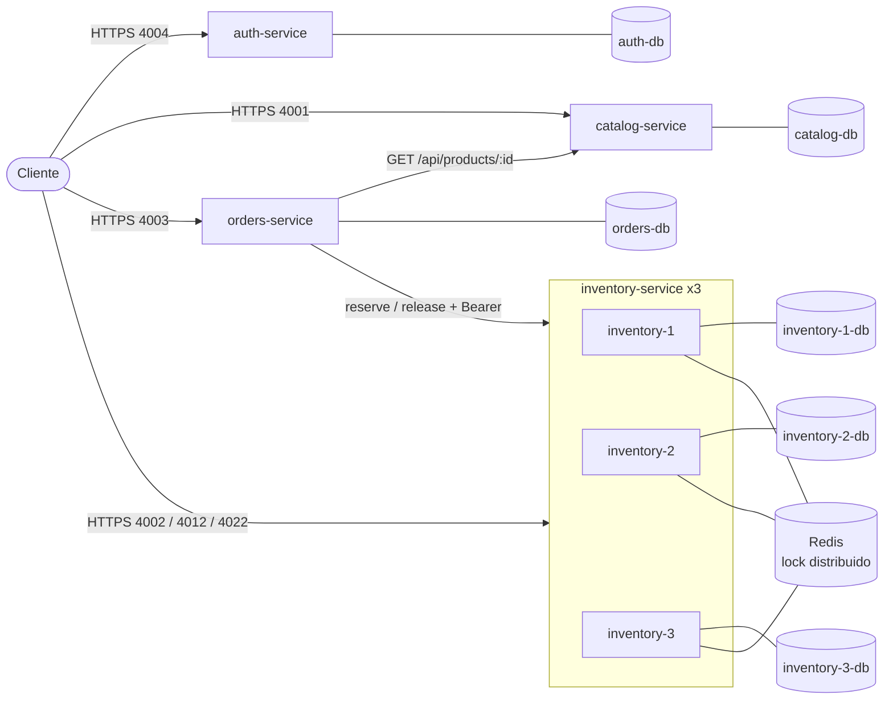

# Voltix

Tienda online de accesorios de computación construida como un sistema de **microservicios** en Node.js, para los TP 1 a 7 de Programación Distribuida (UCH).

Cada servicio es independiente: tiene su propio `package.json`, su propia base MongoDB y se comunica con los demás por HTTP. La autenticación usa JWT firmado por `auth-service` y validado localmente por cada servicio.

## Arquitectura



| Servicio | Responsabilidad |
|---|---|
| **auth-service** | Registro, login y emisión de JWT (HS256, issuer `voltix-auth-service`, claims `sub`, `role`, `iat`, `exp`). |
| **catalog-service** | Productos del catálogo (CRUD, búsqueda y paginación). |
| **inventory-service** | Stock y reservas por orden. Las escrituras se hacen en exclusión mutua por producto con un lock en Redis (`SET NX PX` + liberación con script Lua). Corre como 3 nodos. |
| **orders-service** | Órdenes de compra: valida productos en catálogo, reserva stock en inventario y libera el stock al cancelar. Reenvía el header `Authorization`. |

**Stack:** Node.js 24, Express 5, Mongoose 9, MongoDB 7, Redis 7, Winston (con rotación de archivos), Swagger UI, JWT, Docker Compose.

## Estructura del repo

```
Voltix/
├── auth-service/        cada servicio: src/{config,routes,controllers,services,
├── catalog-service/                         clients,models,middlewares,docs,utils}
├── inventory-service/   + scripts/race-demo.js
├── orders-service/
├── scripts/gen-certs.ps1   certificado HTTPS autofirmado
└── docker-compose.yml
```

## Puertos y rutas

| Servicio | HTTP local | HTTPS local | HTTPS en Docker (host) | Base | Swagger |
|---|---|---|---|---|---|
| catalog-service | 3001 | 4001 | 4001 | `catalog_db` | `/api-docs` |
| inventory-service | 3002 | 4002 | 4002 · 4012 · 4022 (nodos 1, 2, 3) | `inventory_db` | `/api-docs` |
| orders-service | 3003 | 4003 | 4003 | `orders_db` | `/api-docs` |
| auth-service | 3004 | 4004 | 4004 | `auth_db` | `/api-docs` |

- Todos los servicios exponen `GET /health` → `{ "service": "...", "status": "ok" }`.
- La especificación OpenAPI en JSON está en `/api-docs.json`.
- En Docker cada servicio escucha HTTP en el puerto interno `3000` y HTTPS en `3443`. Al host **solo se publican los puertos HTTPS**. MongoDB y Redis no se publican.

Ejemplos con Docker:

- https://localhost:4001/api-docs (catálogo)
- https://localhost:4002/api-docs (inventario, nodo 1)
- https://localhost:4003/api-docs (órdenes)
- https://localhost:4004/api-docs (auth)

El certificado es autofirmado: el navegador muestra una advertencia que hay que aceptar.

## Variables de entorno

Cada servicio tiene un `.env.example` (para correrlo en local) y un `.env.docker.example` (para Docker). Los archivos reales `.env` y `.env.docker` **no se versionan**.

| Variable | Servicios | Descripción |
|---|---|---|
| `SERVICE_NAME`, `NODE_ENV` | todos | Nombre que aparece en logs y en `/health`. |
| `PORT` | todos | Puerto HTTP (local: 300x; Docker: 3000). |
| `HTTPS_ENABLED`, `HTTPS_PORT` | todos | Activa HTTPS y su puerto (local: 400x; Docker: 3443). |
| `SSL_KEY_PATH`, `SSL_CERT_PATH` | todos | Rutas del certificado (local: `../certs/...`; Docker: `/certs/...`). |
| `MONGODB_URI` | todos | Base propia del servicio. |
| `MONGO_RETRY_MS`, `MONGO_MAX_RETRIES` | todos | Reintentos de conexión a MongoDB al arrancar. |
| `JWT_SECRET` | todos | Secreto HS256 compartido, **mínimo 32 caracteres**, igual en los 4 servicios. |
| `CATALOG_SERVICE_URL` | inventory, orders | URL de catalog-service. |
| `INVENTORY_SERVICE_URL` | orders | URL de inventory-service; admite varias separadas por comas (3 nodos). |
| `AUTH_SERVICE_URL` | orders | URL de auth-service. |
| `REDIS_URL` | inventory | Redis para el lock distribuido. |
| `LOCK_ENABLED` | inventory | `false` solo para la demo de condición de carrera. |
| `LOCK_TTL_MS` | inventory | Vencimiento del lock (default 5000). |
| `LOCK_WAIT_MS`, `LOCK_RETRY_MS` | inventory | Espera máxima para tomar el lock (si se supera: 503 + `Retry-After`) y pausa entre reintentos. |
| `DEMO_DELAY_MS` | inventory | Retardo artificial dentro de la sección crítica (0 = desactivado). |
| `LOG_LEVEL`, `LOG_TO_FILES`, `LOG_DIR`, `LOG_MAX_SIZE`, `LOG_MAX_FILES` | todos | Logging con Winston: consola y archivos rotativos con retención. |

Nunca se escribe `localhost` fijo en el código: todas las URLs salen de variables.

## Requisitos

- Node.js 24 y npm (para correr en local)
- Docker Desktop (para correr todo con Docker Compose)
- Git for Windows (trae `openssl`, que usa el script de certificados)

## Certificado HTTPS

Una sola vez, desde la raíz del repo (PowerShell):

```powershell
powershell -ExecutionPolicy Bypass -File scripts\gen-certs.ps1
```

Genera `certs/server.key` y `certs/server.crt`. Los usan todos los servicios, tanto en local como en Docker. La carpeta `certs/` no se versiona.

## Cómo levantarlo en local

Hace falta MongoDB en `localhost:27017` y, para inventory-service, Redis en `localhost:6379`. Si no los tenés instalados, levantá solo esas dos dependencias con Docker:

```powershell
docker run -d --name voltix-mongo -p 27017:27017 mongo:7
docker run -d --name voltix-redis -p 6379:6379 redis:7-alpine
```

Después, en una terminal por servicio:

```powershell
cd catalog-service
npm install
copy .env.example .env
npm run seed      # carga productos de ejemplo
npm run dev
```

```powershell
cd inventory-service
npm install
copy .env.example .env
npm run seed      # lee los productos del catálogo y crea stock 50 para cada uno
npm run dev
```

Lo mismo para `orders-service` y `auth-service`. El seed de inventario necesita que catalog-service esté corriendo.

## Cómo levantarlo con Docker

1. Generar el certificado (ver arriba).
2. Crear el `.env.docker` de cada servicio y poner el **mismo** `JWT_SECRET` en los cuatro:

   ```powershell
   copy catalog-service\.env.docker.example   catalog-service\.env.docker
   copy inventory-service\.env.docker.example inventory-service\.env.docker
   copy orders-service\.env.docker.example    orders-service\.env.docker
   copy auth-service\.env.docker.example      auth-service\.env.docker
   ```

3. Construir y levantar:

   ```powershell
   docker compose up -d --build
   docker compose ps          # todos tienen que quedar "healthy"
   ```

4. Cargar datos de ejemplo:

   ```powershell
   docker compose exec catalog-service node src/seed.js
   1..3 | ForEach-Object { docker compose exec "inventory-$_" node src/seed.js }
   ```

Para levantar solo una parte (por ejemplo, mientras un servicio todavía no está terminado):

```powershell
docker compose up -d --build catalog-service inventory-1 inventory-2 inventory-3
```

Otros comandos útiles:

```powershell
docker compose logs -f inventory-1   # ver logs de un servicio
docker compose down                  # apagar (los datos quedan en los volúmenes)
docker compose down -v               # apagar y borrar los datos
```

### Qué incluye el docker-compose

- Un `Dockerfile` por servicio: `node:24-alpine`, `npm ci --omit=dev`, usuario `node` (no root), `EXPOSE 3000` y `HEALTHCHECK` con `node` + `fetch` al `/health` (sin curl).
- Un MongoDB por servicio, y uno por cada nodo de inventario (`inventory-1-db`, `inventory-2-db`, `inventory-3-db`).
- Redis compartido por los 3 nodos de inventario, para que el lock sea distribuido entre todos.
- Red `backend` interna para las bases y Redis (sin acceso desde afuera) y red `edge` para los servicios.
- Volúmenes con nombre para los datos.
- Healthchecks en MongoDB y Redis, y `depends_on` con `condition: service_healthy`: cada servicio arranca recién cuando sus dependencias están sanas.
- Certificados montados de solo lectura desde `./certs`.

## Demo de condición de carrera (TP2)

`inventory-service/scripts/race-demo.js` dispara N reservas simultáneas contra un producto con poco stock.

1. **Sin lock:** en el `.env` (o `.env.docker`) de inventario poner `LOCK_ENABLED=false` y `DEMO_DELAY_MS=200`, y reiniciar el servicio. Resultado: se aceptan más reservas que el stock (sobreventa).
2. **Con lock:** `LOCK_ENABLED=true` (con el mismo `DEMO_DELAY_MS=200`), reiniciar. Resultado: se aceptan exactamente tantas reservas como stock; el resto recibe 409.

En local:

```powershell
cd inventory-service
node scripts/race-demo.js --product <productId> --n 20 --stock 5
```

En Docker, desde adentro del contenedor:

```powershell
docker compose exec inventory-1 node scripts/race-demo.js --url http://localhost:3000 --product <productId>
```

Cuando auth-service esté integrado, pasar un token de ADMIN con `--token <jwt>`.

## Forma de trabajo

- `main` = estable, `develop` = integración.
- Una rama `feature/<tarea>` por tarea, creada desde `develop`, con Pull Request hacia `develop`.
- Cada integrante revisa el PR de otra persona, no el suyo.
- Commits en español, cada una con su propia cuenta de GitHub.
- Nunca se suben `.env`, `.env.docker`, `certs/`, `node_modules` ni logs.
